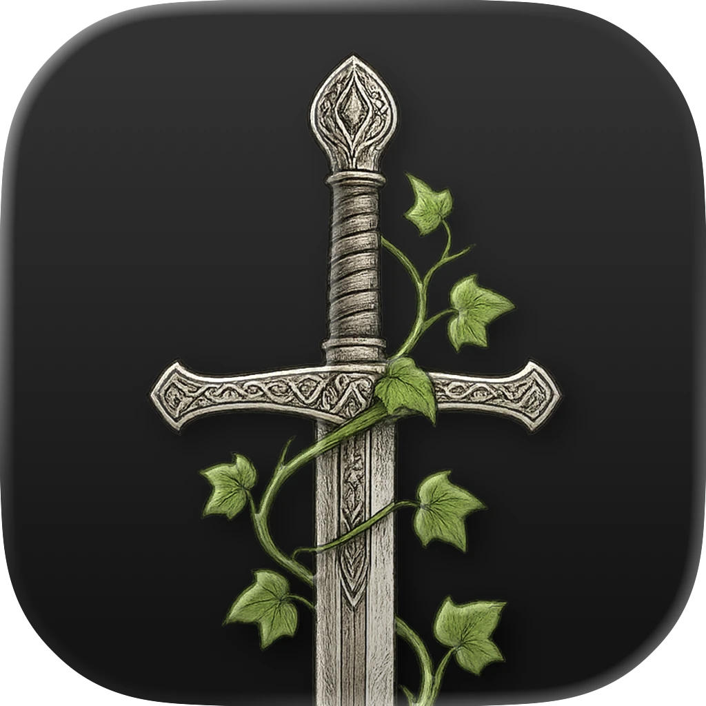
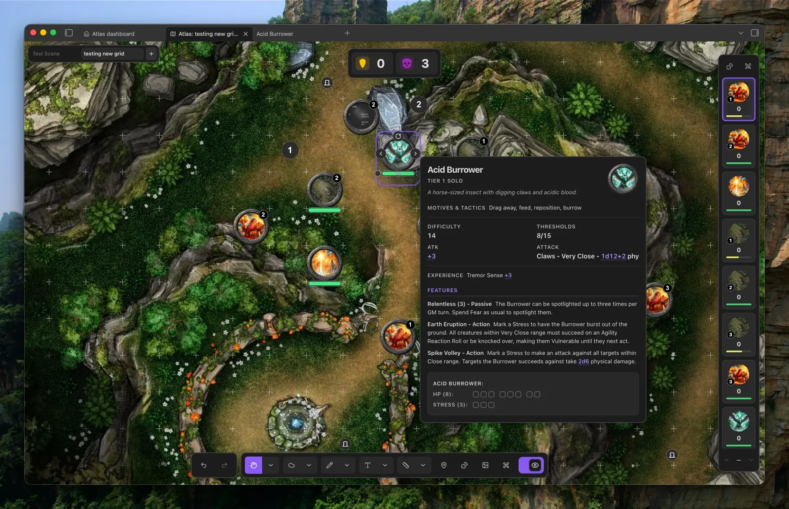
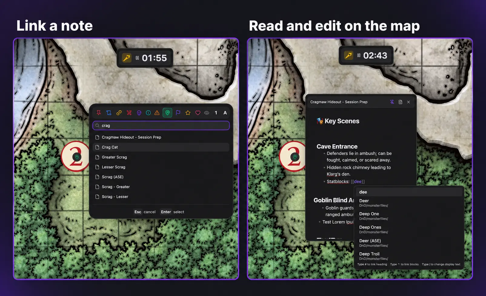
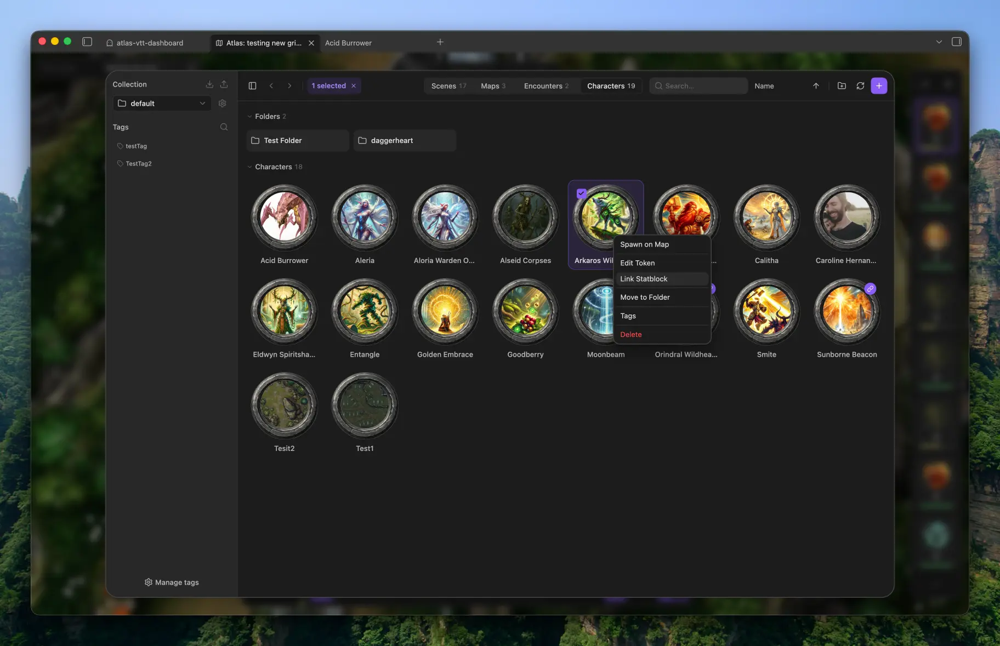
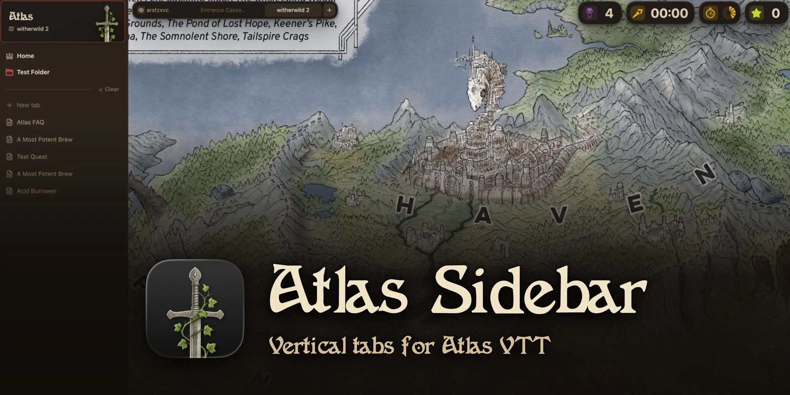

<p align="center">
  
</p>

# AtlasVTT

A game system agnostic virtual tabletop for tabletop RPGs that runs inside [Obsidian](https://obsidian.md). 

The guides, with screenshots and clips of every feature, are on **[atlas-vtt.dev](https://atlas-vtt.dev)**.

I built Atlas as part of my bachelor's thesis to give the TTRPG community a virtual tabletop that's open source, hackable, and free to use. Every file Atlas creates, every token, every map, every world you build, stays yours and stays local. It follows the same philosophy as Obsidian: your work lives on your machine, in formats you control, with no account and no server in between. Atlas VTT also has an online play service, Atlas Online, to share your maps with players over the internet. Atlas Online requires an account and an internet connection.

TTRPG worlds in my opinion are something very personal and players and DMs get attached to them. That attachment deserves better than a subscription and someone else's database. Atlas makes sure your creative output stays yours, just like a sheet of paper would.

Ease of use matters just as much to me. Atlas aims for a minimal, streamlined interface that feels native to Obsidian, with clear controls and simple workflows that keep your attention on the game.

AtlasVTT is desktop only for now

Documentation at: [atlas-vtt.dev](https://atlas-vtt.dev/)



## At the table

- **Maps and grids:** Build scenes from your own map images. Align square or hex grids manually or with automatic detection.
- **Tokens and encounters:** Import characters, move and resize tokens, and save groups as reusable encounters. Link creature notes with the optional [Fantasy Statblocks](https://github.com/javalent/fantasy-statblocks) plugin. Simple die syntax like 2d8+2 will be turned into a clickable dice roll.
- **Fog and player view:** Reveal the map as your players explore. Show a separate player window on a second screen while keeping GM information hidden.
- **Drawing and notes:** Sketch, add text, measure distances, and pin Markdown notes or other Atlas maps to locations.
- **Dice and initiative:** Roll dice, review the roll log, track turns, and keep counters and timers close at hand.
- **Music and controls:** Play audio from your vault, customise map hotkeys, and undo or redo map edits.
- **Online play (closed beta):** Host a table that your players join from their web browsers. It is off until you turn it on, and hosting needs an Atlas account with closed beta access.

## Your notes, right on the map

Pin an Obsidian markdown note or even another Atlas map to a location, then read and edit it in a floating panel without leaving the map. Keep room descriptions, session prep, and character details close at hand, with Obsidian's familiar note linking built in.



## Organise your campaign

Keep scenes, maps, encounters, and characters together in collections. Use folders and tags to find what you need, then bring it onto the map.



## Atlas Sidebar

[Atlas Sidebar](https://github.com/atlas-vtt/atlas-sidebar) is an optional companion plugin. It turns Obsidian's tabs into a vertical list with pinned tabs, folders, essentials and spaces, and keeps a pin at the top that takes you back to your scene in one click.

[](https://github.com/atlas-vtt/atlas-sidebar)

## Install

Requires **Obsidian 1.8.7 or newer on desktop**. Atlas VTT is available through Obsidian's community plugins.

1. Open **Settings → Community plugins** and turn off **Restricted mode** if it is enabled.
2. Select **Browse** and search for **Atlas VTT**.
3. Select **Install**, then **Enable**.

Check for updates under **Settings → Community plugins**.

New to Atlas? [Start here](https://atlas-vtt.dev/docs/start/install) takes you from installing it to showing your first map to your players.

Want to try upcoming features early? Beta builds are available through BRAT, see [.github/beta-testing.md](.github/beta-testing.md).

In the beta, **Random tables → New table** turns pasted text into a Markdown table in your collection. Copy a table from a PDF, spreadsheet, website or Markdown note, enter its name and review the preview before choosing **Save and roll**.

The imports stay on your device. The XLSX reader uses the `http://schemas.openxmlformats.org` XML namespace identifiers locally and makes no requests to that address.

<details>
<summary>Manual installation</summary>

Download `main.js`, `manifest.json`, and `styles.css` from a [GitHub release](https://github.com/ByteMirror/atlas-vtt/releases). Place them in `<your vault>/.obsidian/plugins/atlas-vtt/`, then enable Atlas VTT under **Settings → Community plugins**.

</details>

## Your first scene

1. Run **Atlas VTT: Open dashboard** from the command palette.
2. Use the **+** button in the asset manager to import a map image, then create a scene using that map.
3. Align the grid with automatic detection or the manual alignment tool.
4. Import tokens and place them on your scene.
5. For a local game, open the player view and move it to your second screen.

## Privacy and network use

Atlas works offline with files in your vault. It has no telemetry or ads, and you need no account to use it. Scenes are saved as `.atlasmap` files, and the rest of your library (tokens, encounters, collection settings, game system presets) as JSON files in the `atlas-vtt` folder, so it syncs with your vault. With Obsidian Sync, turn on "Sync all other types".

If you use an external image URL for a token or map background, or copy an externally hosted image from a note, Atlas downloads that image from the supplied address. To tell you when an update is out, Atlas reads the version number of its newest release from GitHub (`raw.githubusercontent.com`) once when Obsidian starts and then every hour. Nothing about you or your vault is sent, and you can switch this off in **Settings → Atlas VTT → Updates**. Vault images require no network access. When you explicitly submit an issue report, Atlas sends it to `https://srv1871379.hstgr.cloud/atlas/reports`, which creates a public GitHub issue. Online play (closed beta) is off until you turn it on in the command palette's **Experimental features** page. Hosting a table needs an Atlas account: you sign in at `https://api.atlas-vtt.dev`, and a running table connects to `https://play.atlas-vtt.dev`, which passes the scene your players may see on to their browsers and keeps none of it. Players need no account. See [PRIVACY.md](PRIVACY.md) for details.

## Help and contributing

Found a bug or have an idea? Run the **Report an issue** command inside Obsidian or use **Settings → Atlas VTT → Help and feedback**. Atlas fills in your versions and submits your report directly, without a GitHub account or a second form; see [.github/reporting-issues.md](.github/reporting-issues.md). To contribute code, see [CONTRIBUTING.md](CONTRIBUTING.md).

<details>
<summary>Build from source</summary>

Requires Node.js 22 or newer.

```bash
npm ci
npm run build   # production build into ./dist
npm run dev     # watch build
npm test
```

The build also copies the plugin into local test vaults when they are present.

</details>

## Game system templates

Atlas VTT comes with statblock templates for 5E, Cairn, Draw Steel and Fate. Each holds the fields and layout of a statblock, not rules text or creatures. Atlas VTT arranged the stat block structure as an editable template.

- 5E (2014 rules): This work includes material taken from the System Reference Document 5.1 ("SRD 5.1") by Wizards of the Coast LLC and available at https://dnd.wizards.com/resources/systems-reference-document. The SRD 5.1 is licensed under the Creative Commons Attribution 4.0 International License available at https://creativecommons.org/licenses/by/4.0/legalcode.
- 5E (2024 rules): This work includes material from the System Reference Document 5.2.1 ("SRD 5.2.1") by Wizards of the Coast LLC, available at https://www.dndbeyond.com/srd. The SRD 5.2.1 is licensed under the Creative Commons Attribution 4.0 International License, available at https://creativecommons.org/licenses/by/4.0/legalcode.
- Cairn: The Cairn template is based on Cairn by Yochai Gal (https://cairnrpg.com), licensed under CC BY-SA 4.0 (https://creativecommons.org/licenses/by-sa/4.0/). Atlas VTT adapted the creature format into an editable template; this template is available under CC BY-SA 4.0 or GPL-3.0.
- Fate: This work is based on Fate Core System and Fate Accelerated Edition (found at https://www.faterpg.com/), products of Evil Hat Productions, LLC, developed, authored, and edited by Leonard Balsera, Brian Engard, Jeremy Keller, Ryan Macklin, Mike Olson, Clark Valentine, Amanda Valentine, Fred Hicks, and Rob Donoghue, and licensed for our use under the Creative Commons Attribution 3.0 Unported license (https://creativecommons.org/licenses/by/3.0/).

The Draw Steel statblock template and system preset in Atlas VTT are an independent product published under the DRAW STEEL Creator License and are not affiliated with MCDM Productions, LLC. DRAW STEEL © 2026 MCDM Productions, LLC.

## Credits and license

Widget icons, map pin icons, light marker icons, the dashboard's icons, the token icon and the end-combat icon are by Lorc, Delapouite, Skoll, sbed, Carl Olsen, and Caro Asercion from [game-icons.net](https://game-icons.net), under [CC BY 3.0](https://creativecommons.org/licenses/by/3.0/). Their backgrounds were removed and glyphs recoloured. The starter class tokens are icons by [Sketch Studio](https://www.fiverr.com/sketchstudioart), commissioned by Maatlock of [maatlockstavern.com](https://maatlockstavern.com), under [CC BY 4.0](https://creativecommons.org/licenses/by/4.0/), redrawn as pencil sketches on parchment. Other asset and library credits are in [THIRD_PARTY_NOTICES.md](THIRD_PARTY_NOTICES.md).

Atlas VTT is free software. Copyright (C) 2025-2026 Fabian Urbanek.

You can use it for any purpose, including streamed, recorded, and paid games. You can redistribute and modify it under the terms of the [GNU Affero General Public License, version 3](LICENSE) (`AGPL-3.0-only`) as published by the Free Software Foundation. If you distribute Atlas VTT or a modified version, or let others use a modified version over a network, you must make the complete source code available under the same license. It is distributed in the hope that it will be useful, but without any warranty; see the license for details.

Additional permission under GNU AGPL version 3 section 7: if you modify this program, or any covered work, by linking or combining it with [Obsidian](https://obsidian.md) (or a modified version of that program), the licensors of this program grant you additional permission to convey the resulting work.

Releases up to and including 0.1.6 were published under the PolyForm Noncommercial License 1.0.0. If you want to use the code under different terms, contact Fabian Urbanek.

Your campaign content remains yours. Third-party components retain their own licenses.
